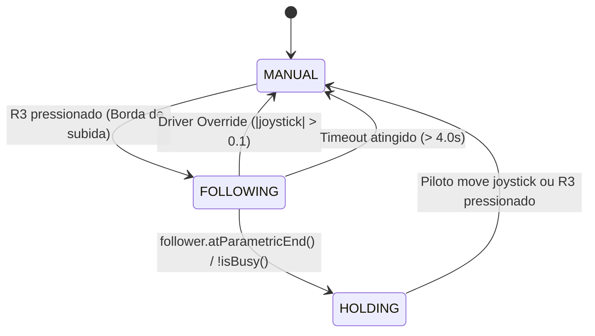

# Plano de Implementação: Classe `AutoPath` (Pedro Pathing no TeleOp)

## Descrição do Objetivo
Implementar a classe `AutoPath` no pacote `org.firstinspires.ftc.teamcode.Autonomo.pedro`.
A classe atua como controladora de navegação assistida durante o modo **TeleOperado**, permitindo que o robô navegue da sua pose atual $(X_1, Y_1)$ até uma pose pré-definida na arena $(X_2, Y_2)$ ao pressionar o botão **R3** (`gamepad1.right_stick_button`) do gamepad.

A execução é não-bloqueante, preserva os demais mecanismos ativos (turret, intake, shooter) e conta com interrupção instantânea pelo piloto (*Driver Override*).

---

## Detalhes de Arquivo e Pacote
- **Arquivo**: `TeamCode/src/main/java/org/firstinspires/ftc/teamcode/Autonomo/pedro/AutoPath.java`
- **Pacote**: `org.firstinspires.ftc.teamcode.Autonomo.pedro`
- **Dependências**: `com.pedropathing:core:3.0.0`, `com.qualcomm.robotcore`

---

## User Review Required

> [!IMPORTANT]
> **Permissão para Implementação**: De acordo com as diretrizes da equipe, solicitamos sua aprovação formal deste plano para criar o arquivo `AutoPath.java` e rodar a validação do build.

---

## Máquina de Estados e Funcionamento



### Regras de Operação
1. **Acionamento (R3)**:
   - Detecta borda de subida (`r3 && !lastR3`) do `gamepad1.right_stick_button`.
   - Lê a pose atual diretamente do `follower.pose()`.
   - Gera dinamicamente o caminho com `Paths.line(currentPose, targetPose).linear(currentPose, targetPose)`.
   - Inicia o trajeto com `follower.follow(path)` e reseta o cronômetro de segurança.

2. **Driver Override (Segurança Máxima)**:
   - Se o piloto mover qualquer analógico de tração (`Math.hypot(forward, strafe) > 0.1 || Math.abs(turn) > 0.1`), o autônomo cancela imediatamente (`follower.stop()`) e entrega controle manual total ao piloto.

3. **Conclusão & Hold**:
   - Ao atingir o destino (`follower.atParametricEnd() || !follower.isBusy()`), passa para `HOLDING` segurando a pose com `follower.hold(targetPose)`.
   - Qualquer toque no analógico remove o modo hold e devolve o manual.

---

## Código Proposto

### [NEW] `TeamCode/src/main/java/org/firstinspires/ftc/teamcode/Autonomo/pedro/AutoPath.java`

```java
package org.firstinspires.ftc.teamcode.Autonomo.pedro;

import static com.pedropathing.api.Paths.line;

import com.pedropathing.follower.Follower;
import com.pedropathing.math.Pose;
import com.pedropathing.paths.Path;
import com.qualcomm.robotcore.hardware.Gamepad;
import com.qualcomm.robotcore.util.ElapsedTime;

/**
 * Classe responsavel pela navegacao assistida com Pedro Pathing durante o TeleOp.
 * Acionada pelo botao R3 (right_stick_button).
 */
public class AutoPath {

    public enum State {
        MANUAL,
        FOLLOWING,
        HOLDING
    }

    // Pose padrao predefinida na arena (ex: posicao de pontuacao/score)
    // Coordenadas em polegadas e radianos
    public static final Pose DEFAULT_SCORE_POSE = new Pose(57.0, 14.6, Math.toRadians(180));

    private final Follower follower;
    private Pose targetPose;
    private State state = State.MANUAL;

    // Controle de borda do botao R3
    private boolean lastR3 = false;

    // Timeout e seguranca
    private final ElapsedTime timer = new ElapsedTime();
    private double maxPathTimeSeconds = 4.0;

    // Limiar para o driver override
    private static final double OVERRIDE_THRESHOLD = 0.1;

    public AutoPath(Follower follower) {
        this(follower, DEFAULT_SCORE_POSE);
    }

    public AutoPath(Follower follower, Pose defaultTarget) {
        this.follower = follower;
        this.targetPose = defaultTarget;
    }

    public void setTargetPose(Pose target) {
        this.targetPose = target;
    }

    public Pose getTargetPose() {
        return targetPose;
    }

    public State getState() {
        return state;
    }

    public boolean isBusy() {
        return state == State.FOLLOWING;
    }

    /**
     * Atualiza a logica da classe a cada ciclo do loop do TeleOp.
     *
     * @param gamepad Gamepad principal (gamepad1)
     */
    public void update(Gamepad gamepad) {
        boolean r3 = gamepad.right_stick_button;
        boolean r3PressedEdge = r3 && !lastR3;
        lastR3 = r3;

        double forward = -gamepad.left_stick_y;
        double strafe  = gamepad.left_stick_x;
        double turn    = gamepad.right_stick_x;

        boolean driverInput = Math.hypot(forward, strafe) > OVERRIDE_THRESHOLD || Math.abs(turn) > OVERRIDE_THRESHOLD;

        switch (state) {
            case MANUAL:
                if (r3PressedEdge && targetPose != null) {
                    startPathToTarget();
                } else {
                    follower.manual(forward, strafe, turn);
                }
                break;

            case FOLLOWING:
                // Sobrescrita imediata se o piloto tocar nos direcionais
                if (driverInput) {
                    cancelToManual();
                    follower.manual(forward, strafe, turn);
                    break;
                }

                // Protecao contra bloqueios ou colisao
                if (timer.seconds() > maxPathTimeSeconds) {
                    cancelToManual();
                    break;
                }

                // Verificacao de chegada
                if (follower.atParametricEnd() || !follower.isBusy()) {
                    state = State.HOLDING;
                    follower.hold(targetPose);
                }
                break;

            case HOLDING:
                // Se o piloto se mover ou pressionar R3 novamente, sai do HOLD
                if (driverInput || r3PressedEdge) {
                    cancelToManual();
                    follower.manual(forward, strafe, turn);
                }
                break;
        }

        // Mantem odometria e controladores do Follower atualizados
        follower.update();
    }

    /**
     * Gera dinamicamente o Path da posicao atual ate a pose alvo e inicia seguimento.
     */
    public void startPathToTarget() {
        Pose currentPose = follower.pose();
        Path pathToTarget = line(currentPose, targetPose).linear(currentPose, targetPose);
        follower.follow(pathToTarget);
        state = State.FOLLOWING;
        timer.reset();
    }

    /**
     * Cancela a trajetoria e devolve controle manual ao piloto.
     */
    public void cancelToManual() {
        follower.stop();
        state = State.MANUAL;
    }
}
```

---

## Verificação e Testes
1. **Compilação**:
   - Rodar `./gradlew compileDebugSources` para validar síntaxe, imports e tipos da biblioteca Pedro Pathing.
2. **Integração no TeleOp**:
   - Adicionar instância no `TeleOp_BLUE.java` / `TeleOp_RED.java` com `autoPath = new AutoPath(follower)`.
   - Executar no robô real e validar transição `MANUAL -> FOLLOWING -> HOLDING -> MANUAL`.
