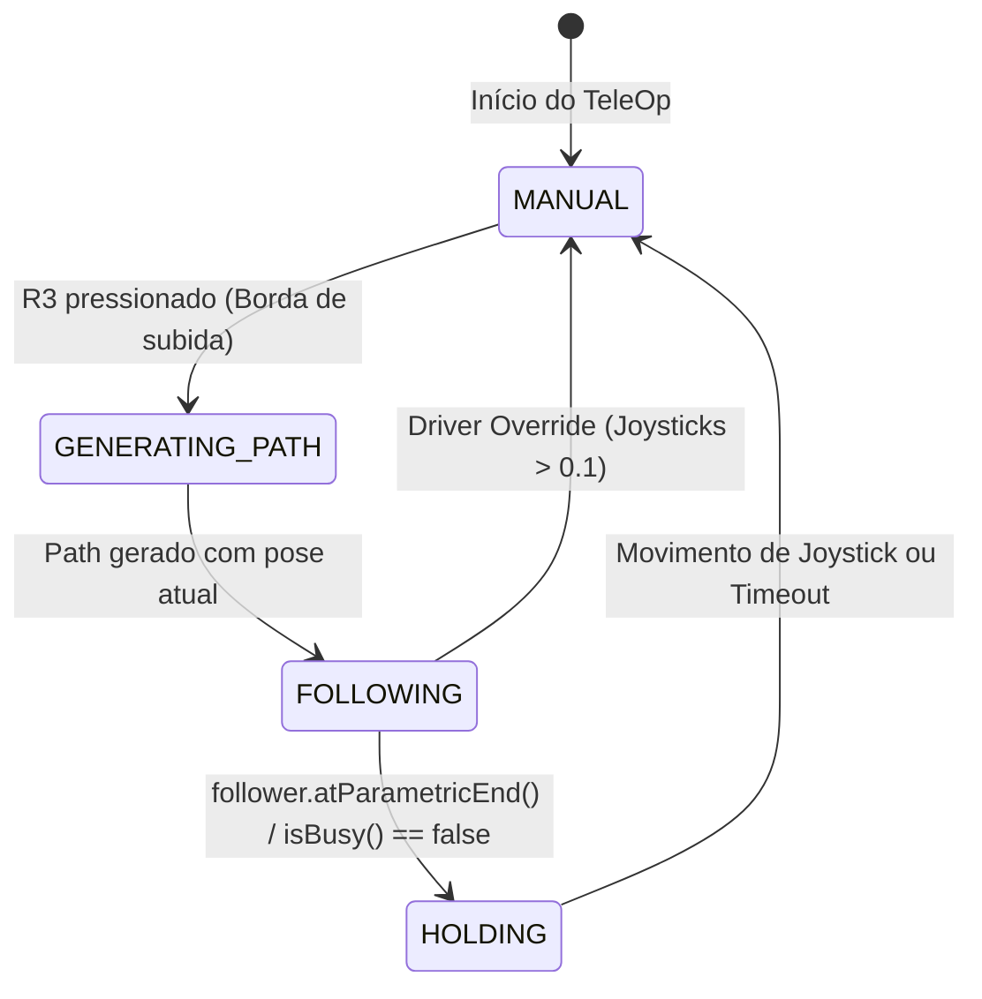

# Plano de Implementação: Navegação Assistida em TeleOp com Pedro Pathing

## Descrição do Objetivo
Implementar uma nova classe controladora (`TeleOpPathFollower` ou `TeleOpAligner`) que integra o **Pedro Pathing** ao modo **TeleOperado**. 

Ao pressionar o botão **R3** (`gamepad1.right_stick_button`), o sistema captura dinamicamente a posição atual do robô $(X_1, Y_1, \theta_1)$ via odometria (`PinpointLocalizer`), gera um trajeto (`Path`) direto até uma pose pré-definida na arena $(X_2, Y_2, \theta_2)$ e executa a trajetória de forma não-bloqueante. O sistema conta com controle de estados, detecção de conclusão e sobreposição manual imediata (*driver override*).

---

## User Review Required

> [!IMPORTANT]
> **Definição do Arquivo e Localização**: Você não indicou o nome nem a pasta onde deseja criar a nova classe. Sugerimos `TeamCode/src/main/java/org/firstinspires/ftc/teamcode/Mech/TeleOpPathFollower.java` (como subsistema mecânico/controle) ou `TeamCode/src/main/java/org/firstinspires/ftc/teamcode/TeleOperados/TeleOpPathFollower.java`.
>
> **Conflito de Motores (Drivetrain vs Follower)**: No código atual de `TeleOp_BLUE.java`, a classe `Chassi` comanda diretamente os 4 motores de tração (`leftFront`, `leftBack`, `rightFront`, `rightBack`). O Pedro Pathing (`Follower`) também controla os mesmos motores. Recomendamos usar o `Follower` como controlador unificado da tração no TeleOp (`follower.manual(...)` para direção manual e `follower.follow(...)` para auto-alinhamento), evitando conflitos entre duas classes controlando as mesmas portas de motor.

---

## Perguntas em Aberto

> [!WARNING]
> 1. **Coordenadas do Alvo**: Quais são as coordenadas exatas da arena para o alvo padrão $(X, Y, \text{heading})$? (Ex: Posição de pontuação na Hive ou Cesto).
> 2. **Direção Manual no TeleOp**: Deseja manter o controle manual padrão do robô usando `Follower.manual(...)` ou manter `Chassi.java` ativo apenas enquanto o autônomo estiver inativo? (Unificar no `Follower` é mais limpo e suporta Field-Centric nativo via `ManualDrive.fieldCentric`).
> 3. **Comportamento ao Final do Trajeto**: Ao chegar na pose pré-definida, o robô deve segurar ativamente a pose (`follower.hold(...)`) até o piloto intervir ou parar os motores e devolver o controle manual imediatamente?

---

## Arquitetura Proposta



### Componentes Principais da Nova Classe

1. **Máquina de Estados (`FollowerState`)**:
   - `MANUAL`: Piloto tem controle total dos analógicos.
   - `FOLLOWING`: Pedro Pathing conduz o robô autonomamente até o alvo.
   - `HOLD`: Robô segura a pose com PID após atingir o ponto final.

2. **Detecção de Borda de Subida do R3**:
   - Evita recriação repetida do caminho a cada ciclo de 10ms enquanto o botão estiver pressionado.

3. **Construção Dinâmica do Path**:
   - Lê `follower.pose()`.
   - Gera `Path` usando a biblioteca do Pedro Pathing:
     ```java
     Path path = line(currentPose, targetPose).linear(currentPose, targetPose);
     follower.follow(path);
     ```

4. **Driver Override (Sobrescrita de Segurança)**:
   - Se o piloto tocar nos analógicos (`|stick_x| > 0.1 || |stick_y| > 0.1 || |rx| > 0.1`), o robô cancela imediatamente o trajeto autônomo (`follower.stop()` ou `follower.manual(...)`) e retorna ao modo manual.

5. **Timeout de Segurança**:
   - Caso haja colisão com robôs adversários ou obstáculos, um timer cancela o caminho após $N$ segundos (ex: 4.0s).

---

## Proposta de Código Detalhada

### [NEW] `TeamCode/src/main/java/org/firstinspires/ftc/teamcode/Mech/TeleOpPathFollower.java`

```java
package org.firstinspires.ftc.teamcode.Mech;

import static com.pedropathing.api.Paths.line;

import com.pedropathing.follower.Follower;
import com.pedropathing.math.Pose;
import com.pedropathing.paths.Path;
import com.qualcomm.robotcore.hardware.Gamepad;
import com.qualcomm.robotcore.util.ElapsedTime;

/**
 * Controlador de navegacao assistida para TeleOp com Pedro Pathing.
 */
public class TeleOpPathFollower {

    public enum State {
        MANUAL,
        FOLLOWING,
        HOLDING
    }

    private final Follower follower;
    private Pose targetPose;
    private State state = State.MANUAL;

    // Controle de borda do botao R3
    private boolean lastR3 = false;

    // Timeout de seguranca
    private final ElapsedTime timer = new ElapsedTime();
    private double maxPathTimeSeconds = 4.0;

    // Limiar para driver override
    private static final double OVERRIDE_THRESHOLD = 0.1;

    public TeleOpPathFollower(Follower follower, Pose defaultTarget) {
        this.follower = follower;
        this.targetPose = defaultTarget;
    }

    /**
     * Define novo alvo para navegacao.
     */
    public void setTargetPose(Pose target) {
        this.targetPose = target;
    }

    public Pose getTargetPose() {
        return targetPose;
    }

    public State getState() {
        return state;
    }

    /**
     * Atualiza o loop do controlador no TeleOp.
     * Deve ser chamado todo ciclo de loop() ou while(opModeIsActive()).
     */
    public void update(Gamepad gamepad1) {
        boolean r3 = gamepad1.right_stick_button;
        boolean r3PressedEdge = r3 && !lastR3;
        lastR3 = r3;

        double forward = -gamepad1.left_stick_y;
        double strafe  = gamepad1.left_stick_x;
        double turn    = gamepad1.right_stick_x;

        boolean driverInput = Math.hypot(forward, strafe) > OVERRIDE_THRESHOLD || Math.abs(turn) > OVERRIDE_THRESHOLD;

        switch (state) {
            case MANUAL:
                // Se apertar R3, inicia geracao de caminho e segue
                if (r3PressedEdge && targetPose != null) {
                    startPathToTarget();
                } else {
                    // Direcao manual direta via Follower
                    follower.manual(forward, strafe, turn);
                }
                break;

            case FOLLOWING:
                // Driver override: se mexer nos analógicos, cancela o auto
                if (driverInput) {
                    cancelToManual();
                    follower.manual(forward, strafe, turn);
                    break;
                }

                // Timeout de seguranca
                if (timer.seconds() > maxPathTimeSeconds) {
                    cancelToManual();
                    break;
                }

                // Verifica se concluiu o caminho
                if (follower.atParametricEnd() || !follower.isBusy()) {
                    state = State.HOLDING;
                    follower.hold(targetPose);
                }
                break;

            case HOLDING:
                // Sai do hold ao mexer nos comandos ou ao pressionar outro botao
                if (driverInput || r3PressedEdge) {
                    cancelToManual();
                    follower.manual(forward, strafe, turn);
                }
                break;
        }

        // Atualiza a odometria e controladores do Pedro Pathing
        follower.update();
    }

    /**
     * Gera e inicia a trajetoria da pose atual ate a pose alvo.
     */
    public void startPathToTarget() {
        Pose currentPose = follower.pose();
        Path pathToTarget = line(currentPose, targetPose).linear(currentPose, targetPose);
        follower.follow(pathToTarget);
        state = State.FOLLOWING;
        timer.reset();
    }

    /**
     * Cancela o seguimento e devolve o controle manual ao piloto.
     */
    public void cancelToManual() {
        follower.stop();
        state = State.MANUAL;
    }
}
```

---

### Exemplo de Integração em `TeleOp_BLUE.java`

```java
// 1. Inicializacao (no runOpMode)
Follower follower = Constants.create(hardwareMap);
follower.setPose(START.toPose());

// Alvo predefinido da arena (exemplo: pose de pontuacao)
Pose targetScorePose = new Pose(57.0, 14.6, Math.toRadians(180));
TeleOpPathFollower autoAligner = new TeleOpPathFollower(follower, targetScorePose);

// 2. Loop principal
while (opModeIsActive()) {
    // Substitui drivetrain.drive(...) por:
    autoAligner.update(gamepad1);

    // DEMAIS MECANISMOS (Turret, Feeder, Shooter) CONTINUAM NORMALMENTE:
    // ...
    telemetry.addData("Estado Alinhamento", autoAligner.getState());
    telemetry.update();
}
```

---

## Plano de Verificação

### Compilação e Código
1. Validar referências de `Follower`, `Paths.line`, `Pose` e Gradle via:
   `./gradlew compileDebugSources`

### Teste Manual na Arena / Robô Real
1. Iniciar o OpMode `TeleOp_BLUE`.
2. Dirigir o robô manualmente usando o analógico esquerdo e direito.
3. Posicionar o robô em $(X_1, Y_1)$ qualquer da arena.
4. Pressionar **R3** (`gamepad1.right_stick_button`).
5. Verificar:
   - Robô se desloca autonomamente traçando a linha reta até $(X_2, Y_2)$ e alinha o heading.
   - Ao mover qualquer analógico durante o trajeto, o robô interrompe o movimento autônomo imediatamente (*Driver Override*).
   - Ao atingir a pose de destino sem interrupção, o robô finaliza o trajeto e permanece estabilizado.
